# Overcurrent Relay Coordination: 11 kV Radial Distribution Feeder

This repository implements the protection coordination and grading calculations for a typical Indian **33/11 kV primary distribution substation** and its radial **11 kV overhead distribution feeder**, engineered in accordance with **Indian Standards (IS / IEC / CEA / CBIP)**. 

Four numerical overcurrent relays are coordinated in series: the transformer 11 kV LV incomer breaker, the feeder outgoing breaker, and two line sectionalizing reclosers. The protection engine determines CT ratios, pickup plug settings, time multiplier settings (TMS), and high-set instantaneous (50) overcurrent elements so that the relay nearest to the fault location operates first, while upstream devices provide coordinated backup with a minimum Coordination Time Interval (CTI) of 0.3 s.

```mermaid
graph LR
    Grid["33 kV Grid Source<br/>500 MVA (IS 13234)"] --> Tx["Power Transformer<br/>20 MVA, 33/11 kV<br/>10% Z (IS 2026)"]
    Tx --> R1["[R1] Incomer Breaker<br/>1200/1 A CT"]
    R1 --> Bus0["Bus 0: Substation 11 kV Bus<br/>8.25 kA max / 3.83 kA min"]
    Bus0 --> R2["[R2] Feeder Breaker<br/>400/1 A CT"]
    R2 --> Sec1["Line 1: 4.0 km<br/>ACSR Dog (IS 398)"]
    Sec1 --> Bus1["Bus 1: Section A<br/>Load: 3.0 MVA"]
    Bus1 --> R3["[R3] Recloser A<br/>300/1 A CT"]
    R3 --> Sec2["Line 2: 5.0 km<br/>ACSR Dog (IS 398)"]
    Sec2 --> Bus2["Bus 2: Section B<br/>Load: 2.5 MVA"]
    Bus2 --> R4["[R4] Recloser B<br/>150/1 A CT"]
    R4 --> Sec3["Line 3: 6.0 km<br/>ACSR Dog (IS 398)"]
    Sec3 --> Bus3["Bus 3: Section C<br/>Load: 2.0 MVA"]
```



---

## Applicable Indian & International Standards

1. **IS/IEC 60255-151 / IS 3231**: Measuring relays and protection equipment — standard inverse, very inverse, extremely inverse, and long-time inverse IDMT time-current characteristics.
2. **IS 13234 / IEC 60909**: Guide for short-circuit current calculation in three-phase a.c. distribution networks ($c = 1.1$ for maximum fault, $c = 1.0$ for minimum fault conditions).
3. **IS 398 (Part 2)**: Specifications for Aluminum Conductor Steel Reinforced (ACSR Dog, 100 mm² nominal aluminum area; $r = 0.273\ \Omega/\text{km}$, $x = 0.363\ \Omega/\text{km}$ at 50 Hz).
4. **IS 2026 / CBIP Manual on Transformers**: Specifications for 33/11 kV primary distribution transformers (20 MVA, 10% impedance, $X/R = 15$).
5. **CEA Technical Standards & CBIP Protection Manual (Pub 274/325)**: Guidelines for overcurrent relay grading and coordination time intervals ($\text{CTI} = 0.3\text{ s}$ for numerical relays with 5-cycle breaker clearing time).

---

## Coordinated Relay Settings

| Relay | Location | CT Ratio | Load Current | Pickup Setting | Curve | TMS | Instantaneous (50) |
|---|---|---|---|---|---|---|---|
| **R1** | Incomer (Transformer LV) | 1200/1 A | 1050 A | 1320 A (1.10 × CT) | IS/IEC SI | 0.11 | Disabled |
| **R2** | Feeder Breaker | 400/1 A | 394 A | 600 A (1.50 × CT) | IS/IEC SI | 0.12 | 3.53 kA |
| **R3** | Sectionalizing Recloser A | 300/1 A | 236 A | 360 A (1.20 × CT) | IS/IEC SI | 0.10 | 1.88 kA |
| **R4** | Sectionalizing Recloser B | 150/1 A | 105 A | 158 A (1.05 × CT) | IS/IEC SI | 0.05 | Disabled |

---

## Technical Methodology

1. **Short-Circuit Calculation (Ohmic Method)**:
   - System Base: 11 kV, 50 Hz.
   - Upstream 33 kV fault levels: 500 MVA maximum plant ($c = 1.1$), 250 MVA minimum plant ($c = 1.0$).
   - Three-phase symmetrical maximum faults and phase-to-phase minimum faults are computed along every feeder section using Thevenin network reduction.
2. **Current Pickup & CT Selection**:
   - Transformer incomer pickup is set at $1.25\times$ transformer rated current per IS/CBIP guidelines to permit emergency loading.
   - Feeder breakers and reclosers are set at $\ge 1.5\times$ nominal downstream peak load current to avoid spurious tripping during permissible overloading.
   - Standard primary CT ratings from Indian utility stock are selected with plug settings adjusted in 0.05 steps.
3. **High-Set Instantaneous Overcurrent Elements (ANSI 50)**:
   - Instantaneous elements are set at $1.3\times$ the maximum through-fault current of the downstream bus to ensure boundary discrimination without overreach into downstream line sections.
   - For R1 (Incomer), instantaneous protection is disabled because its protection zone terminates at the same bus as the feeder breaker.
4. **Time Multiplier Setting (TMS) Grading**:
   - Grading proceeds sequentially from the tail of the radial feeder (R4) upstream toward the source incomer (R1).
   - Each relay is graded against its downstream neighbor at critical coordination points:
     - The maximum current on the downstream inverse curve (just below its 50 setting).
     - The maximum fault level where the downstream device clears instantaneously ($t_{\text{inst}} = 0.05\text{ s}$).
   - TMS values are rounded up to the nearest 0.01 step with a minimum TMS floor of 0.05.

---

## Verification & Key Results

- **CTI Compliance Across All Fault Currents**: A continuous fault sweep across all observable currents confirms that the Coordination Time Interval strictly satisfies $\text{CTI} \ge 0.3\text{ s}$ everywhere:
  - R1 / R2 margin: **0.311 s**
  - R2 / R3 margin: **0.310 s**
  - R3 / R4 margin: **0.342 s**
- **Close-in 11 kV Bus Fault (8.25 kA)**: The feeder breaker clears the fault instantaneously in **0.05 s** (ANSI 50), while the incomer backup operates at **0.41 s** (IDMT).
- **Protection Sensitivity**: Minimum phase-to-phase fault current divided by pickup current exceeds **3.0** in all zones (zone sensitivity values: 3.83, 3.28, 3.03, 4.50), exceeding the Indian utility minimum criterion of 1.5.
- **Cross-Validation with Linear Programming**: Solving for optimal TMS values using Scipy's HiGHS linear programming solver independently converges to the exact sequential grading values (maximum difference $< 10^{-9}$).

---

## Project Structure

```
relay/
  __init__.py          Package exports
  curves.py            IS/IEC 60255 IDMT curve equations and trip time calculations
  feeder.py            11 kV radial feeder network model and fault current calculation
  coordination.py      Pickup selection, 50 element reach, TMS sequential grading, and LP solver
tests/
  test_relay.py        Pytest test suite covering curves, fault levels, and coordination
verify.py              Automated verification suite validating all engineering parameters
make_figures.py        Script to plot TCC curves and export single-line diagrams and tables
requirements.txt       Project dependencies
```

---

## Execution Instructions

Install dependencies and run the automated verification suite:

```bash
pip install -r requirements.txt
python verify.py
```

To run unit tests:

```bash
python -m pytest -q
```

To generate time-current coordination characteristics and single-line diagrams:

```bash
python make_figures.py
```

---

**Author**: Anshuman Pattnaik  
**Batch**: OUTR'27, Electrical Engineering  
Odisha University of Technology and Research (OUTR), Bhubaneswar  
